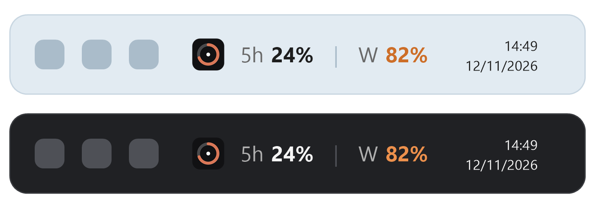

<p align="center">
  
</p>

<h1 align="center">EmberBar</h1>

<p align="center">
  <b>Your Claude usage limits, always in sight on the Windows taskbar.</b><br>
  Small, private, open source, and easy to read in a few minutes.
</p>

<p align="center">
  
  
  
  
</p>

<p align="center">
  
</p>

<p align="center"><sub>Illustration. <b>5h</b> is your 5-hour limit and <b>W</b> is your weekly limit.</sub></p>

<p align="center"><a href="README.md">Leia em português</a></p>

---

## Why EmberBar?

Claude has usage limits that reset every 5 hours and every week. Checking them means opening a page or a command. EmberBar puts both numbers on your taskbar, right next to the clock, so you always know how much room you have left before you hit a limit.

- **Two numbers, one glance.** The 5-hour limit and the weekly limit, updated in the background.
- **Colors that warn you.** Normal text below 70%, orange from 70%, red from 90%.
- **Always shows something.** If an update fails, it keeps the last known values in gray instead of going blank.
- **Private by design.** No telemetry, no analytics, and it talks to only two Anthropic addresses.
- **Auditable.** About 1,250 lines of C# in 9 files, no NuGet packages, and the whole sign-in is readable in one file.
- **Your language.** English, Português (Brasil) and Español, picked from the menu.

## Download

1. Go to the [latest release](https://github.com/canndidojs/emberbar/releases/latest) and download `EmberBar.exe`.
2. Double-click it. Nothing else to install: the .NET runtime is already inside the file.
3. Windows may show a blue **"Windows protected your PC"** screen, because this small free project is not code-signed. Click **More info**, then **Run anyway**.

To check the file is the one built from this code, compare its SHA-256 hash with the one on the release page:

```powershell
Get-FileHash .\EmberBar.exe -Algorithm SHA256
```

Hash of version 1.0.0: `B1C3DD736FB18A610362D0769E0E65CEF74BABC77EF95EC24AF883934D4C5405`

[VirusTotal result](https://www.virustotal.com/gui/file/b1c3dd736fb18a610362d0769e0e65cef74babc77ef95ec24af883934d4c5405): 1 of 65 antivirus engines (Bkav) flags the file heuristically. This is common for small unsigned programs and is a false positive. Microsoft, Kaspersky, BitDefender, Avast and the others detected nothing. The code is open and you can build it yourself.

## Build it yourself

You need the [.NET 8 SDK](https://dotnet.microsoft.com/download/dotnet/8.0) to build (`winget install Microsoft.DotNet.SDK.8`), and the .NET 8 Desktop Runtime to run it.

```powershell
git clone https://github.com/canndidojs/emberbar.git
cd emberbar
dotnet publish -c Release -r win-x64 --self-contained false -p:PublishSingleFile=true -o publish
.\publish\EmberBar.exe
```

On the first run a small black-and-white window asks you to sign in. Click the button, sign in on the page that opens in your browser, and the window tells you EmberBar is running and closes by itself. The strip then stays on your taskbar.

> Prefer not to trust a download? Build it from the code you can read, as above.

## Using it

Right-click the strip to open the menu.

| Menu item | What it does |
|---|---|
| **Refresh now** | Updates the numbers immediately. |
| **Sign in / Sign out** | Starts the sign-in, or deletes the saved session. |
| **Refresh every** | 2, 5, 10, 15 or 30 minutes. The default is 5. |
| **Strip size** | Small, medium or large. |
| **Language** | English, Português (Brasil) or Español. The first run follows your Windows language. |
| **Start with Windows** | Off by default. Shows *On* or *Off*. |
| **Open usage page** | Opens your usage page in the browser. |
| **About EmberBar** | Version, author, and a link to star the project. |
| **Quit** | Closes the app. |

Hover the strip to see the exact percentages, when each limit resets, and when the numbers were last updated.

### Good to know

- The strip hides itself while a full-screen app or game is running, and when the taskbar is on the side of the screen.
- After an error, the wait before the next try doubles (up to 10 minutes) to stay under the API's rate limit.
- It is a small window drawn over the taskbar, not a native taskbar part, because Windows 10 has no supported way to do that. If the taskbar is crowded it can cover the last buttons.
- Built and tested on Windows 10. It may work on Windows 11, but that is untested.

## Privacy and security

| | |
|---|---|
| **Network** | Only `api.anthropic.com` (your usage) and `platform.claude.com` (sign-in and session renewal). Your browser, not the app, opens the sign-in page. |
| **Telemetry** | None. No analytics, no crash reports, no update checks. |
| **Stores** | `%APPDATA%\EmberBar\auth.dat`, your session, encrypted with Windows DPAPI so only your Windows user can read it. And `%APPDATA%\EmberBar\settings.json`, with your interval, size and language. |
| **Registry** | Only if you turn on *Start with Windows*: one value under `HKCU\Software\Microsoft\Windows\CurrentVersion\Run`. |
| **Listens** | One request on `localhost`, on a random port, only while the sign-in window is waiting for you. |
| **Screen** | Reads the color of **one pixel** of the taskbar so the strip's background matches it. Nothing is saved or sent. |
| **Other apps** | Does not read or change any other program's files or logins. |

To verify the network claim yourself: the only addresses the app contacts are `Url` in `Program.cs` and `TokenUrl` in `Auth.cs`.

## How sign-in works

1. EmberBar opens the sign-in page in your default browser, with a random PKCE challenge and `state`.
2. You sign in there. The page sends your browser to `http://localhost:<random port>/callback`, where EmberBar is listening for that single request.
3. EmberBar exchanges the code for a session and saves it, encrypted, in `%APPDATA%\EmberBar\auth.dat`.
4. Before the access token expires, EmberBar renews it in the background. If renewal is refused, it signs you out and asks you to sign in again.

Your password never goes through EmberBar.

## FAQ

**Will my antivirus flag it?**
It should not, but it can happen with any small unsigned program. Windows Defender scanned the build and found nothing. Because you build it yourself, Windows does not show the "downloaded from the internet" warning. If a scanner does flag it, you can report it as a false positive to the vendor.

**Why do I sometimes see gray numbers?**
The last update failed (for example a rate limit or no internet), so EmberBar is showing the last known values. Hover the strip to see when they are from and what failed.

**Why every 5 minutes?**
The usage endpoint is rate limited. A short interval can trigger an error. You can pick a different interval in the menu.

**Does it use my plan's quota?**
It only reads your limits. It never sends messages to the model.

**How do I remove it completely?**
1. Right-click the strip, turn off *Start with Windows*, then *Quit*.
2. Delete the project folder and `%APPDATA%\EmberBar`.
3. Optionally, revoke the app's access in your Claude account settings.

## Project layout

| File | What it does |
|---|---|
| `Program.cs` | Startup, menu, refresh timer and the one usage request. |
| `Auth.cs` | Sign-in (OAuth with PKCE), session renewal and encrypted storage. |
| `Settings.cs` | Saves interval, size and language. |
| `L.cs` | All the text, in three languages. |
| `TaskbarStrip.cs` | The strip drawn on the taskbar. |
| `DarkMenu.cs` | The dark look of the context menu. |
| `MinimalWindow.cs` | Shared black-and-white window style. |
| `LoginWindow.cs` | The sign-in window. |
| `AboutWindow.cs` | The About window. |

## Risks and limits

1. **Unofficial endpoint.** The usage endpoint is not publicly documented and can change or disappear without notice. If that happens the strip stops updating and the tooltip says why.
2. **Borrowed sign-in identity.** Anthropic offers no public sign-in for third-party apps, so EmberBar signs in with the same public OAuth client ID used by Anthropic's own command-line tool (Claude Code). Your account will list the session under that name. Anthropic may change or block this at any time, and it may not be covered by their terms. Use it at your own risk.
3. **Stored session.** It is encrypted with DPAPI, but any program running as your Windows user can ask Windows to decrypt it. Read the code before you run it.

## License

[MIT](LICENSE). Free to use, change and share.

## Author

Made by **[Fabrício Candido](https://github.com/canndidojs)** and Claude Code.

If EmberBar is useful to you, a ⭐ on GitHub helps a lot.

## Disclaimer

EmberBar is an independent project. It is not affiliated with, endorsed by, or sponsored by Anthropic. *Claude* is a trademark of Anthropic, PBC, mentioned here only to say what the app works with. It is provided as is, without warranty of any kind, and you are responsible for reviewing the code and for how you use it.
