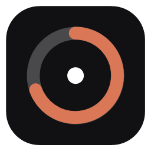
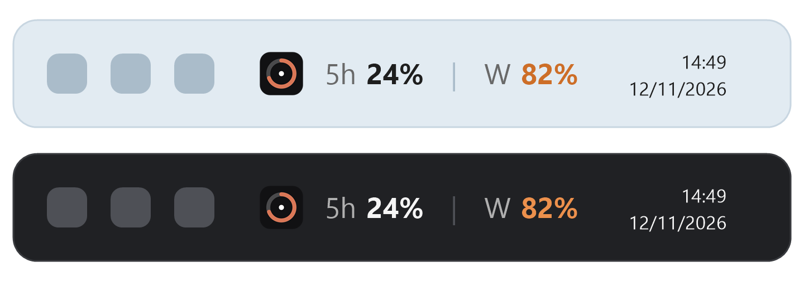

<p align="center">
  
</p>

<h1 align="center">EmberBar</h1>

<p align="center">
  <b>Seus limites de uso do Claude sempre à vista na barra de tarefas do Windows.</b><br>
  Pequeno, privado, de código aberto e fácil de ler em poucos minutos.
</p>

<p align="center">
  
  
  
  
</p>

<p align="center">
  
</p>

<p align="center"><sub>Ilustração. <b>5h</b> é o seu limite de 5 horas e <b>S</b> (<b>W</b> em inglês) é o limite semanal.</sub></p>

<p align="center"><a href="README.en.md">Read in English</a></p>

---

## Por que o EmberBar?

O Claude tem limites de uso que reiniciam a cada 5 horas e a cada semana. Para conferir, você precisa abrir uma página ou um comando. O EmberBar coloca os dois números na barra de tarefas, ao lado do relógio, para você saber sempre quanto ainda tem antes de bater no limite.

- **Dois números, um olhar.** O limite de 5 horas e o semanal, atualizados em segundo plano.
- **Cores que avisam.** Texto normal abaixo de 70%, laranja a partir de 70% e vermelho a partir de 90%.
- **Sempre mostra algo.** Se uma atualização falhar, ele mantém os últimos valores em cinza em vez de ficar em branco.
- **Privado por projeto.** Sem telemetria, sem análise de uso, e só fala com dois endereços da Anthropic.
- **Fácil de auditar.** Cerca de 1.250 linhas de C# em 9 arquivos, sem pacotes NuGet, e todo o login cabe em um arquivo.
- **No seu idioma.** English, Português (Brasil) e Español, escolhidos no menu.

## Baixar

1. Entre na [última versão](https://github.com/canndidojs/emberbar/releases/latest) e baixe o `EmberBar.exe`.
2. Dê dois cliques. Não precisa instalar mais nada: o .NET já vem dentro do arquivo.
3. O Windows pode mostrar uma tela azul **"O Windows protegeu o computador"**, porque este projeto pequeno e gratuito não tem assinatura de código. Clique em **Mais informações** e depois em **Executar assim mesmo**.

Para conferir que o arquivo é o compilado deste código, compare o hash SHA-256 com o da página da versão:

```powershell
Get-FileHash .\EmberBar.exe -Algorithm SHA256
```

Hash da versão 1.0.0: `B1C3DD736FB18A610362D0769E0E65CEF74BABC77EF95EC24AF883934D4C5405`

[Resultado no VirusTotal](https://www.virustotal.com/gui/file/b1c3dd736fb18a610362d0769e0e65cef74babc77ef95ec24af883934d4c5405): 1 de 65 antivírus (Bkav) marca o arquivo por heurística. Isso é comum em programas pequenos sem assinatura e é um falso positivo. Microsoft, Kaspersky, BitDefender, Avast e os demais não detectaram nada. O código é aberto e você pode compilar sozinho.

## Compilar você mesmo

Você precisa do [.NET 8 SDK](https://dotnet.microsoft.com/download/dotnet/8.0) para compilar (`winget install Microsoft.DotNet.SDK.8`) e do .NET 8 Desktop Runtime para rodar.

```powershell
git clone https://github.com/canndidojs/emberbar.git
cd emberbar
dotnet publish -c Release -r win-x64 --self-contained false -p:PublishSingleFile=true -o publish
.\publish\EmberBar.exe
```

Na primeira vez, uma janelinha preta e branca pede o login. Clique no botão, entre na página que abre no navegador, e a janela avisa que o EmberBar está rodando e fecha sozinha. A faixa fica na barra de tarefas.

> Prefere não confiar em um download? Compile a partir do código que você pode ler, como acima.

## Como usar

Clique com o botão direito na faixa para abrir o menu.

| Item do menu | O que faz |
|---|---|
| **Atualizar agora** | Atualiza os números na hora. |
| **Entrar / Sair da conta** | Inicia o login ou apaga a sessão salva. |
| **Atualizar a cada** | 2, 5, 10, 15 ou 30 minutos. O padrão é 5. |
| **Tamanho da faixa** | Pequeno, médio ou grande. |
| **Idioma** | English, Português (Brasil) ou Español. Na primeira vez segue o idioma do Windows. |
| **Alertas de uso** | Notificação do Windows quando um limite chega a 70%, 90% e 100%. Ligado por padrão. |
| **Iniciar com o Windows** | Desligado por padrão. Mostra *Ligado* ou *Desligado*. |
| **Abrir página de uso** | Abre a sua página de uso no navegador. |
| **Sobre o EmberBar** | Versão, autor e um link para dar estrela no projeto. |
| **Sair** | Fecha o app. |

Ao passar o mouse sobre a faixa, aparece um cartãozinho logo acima dela (com animação) com as porcentagens exatas, quando cada limite reinicia (o horário e quanto tempo falta) e quando os números foram atualizados pela última vez.

Quando sai uma versão nova, aparece um item *Atualização disponível* no topo do menu e uma notificação. Clicar leva à página do release.

### Bom saber

- A faixa se esconde enquanto um app ou jogo em tela cheia está aberto, e quando a barra de tarefas está na lateral da tela.
- Depois de um erro, a espera até a próxima tentativa dobra (até 10 minutos) para ficar abaixo do limite de requisições da API.
- É uma janelinha desenhada sobre a barra de tarefas, e não uma parte nativa dela, porque o Windows 10 não tem um jeito oficial de fazer isso. Se a barra estiver lotada, ela pode cobrir os últimos botões.
- Feito e testado no Windows 10. Pode funcionar no Windows 11, mas isso não foi testado.

## Privacidade e segurança

| | |
|---|---|
| **Rede** | Só `api.anthropic.com` (o seu uso), `platform.claude.com` (login e renovação da sessão) e `api.github.com` (para saber se há versão nova, ao abrir e a cada 12 horas; não envia nada além do nome e da versão do app). Quem abre a página de login é o seu navegador, e não o app. |
| **Telemetria** | Nenhuma. Sem análise de uso e sem relatório de falhas. |
| **Guarda** | `%APPDATA%\EmberBar\auth.dat`, a sua sessão, criptografada com o DPAPI do Windows para só o seu usuário conseguir ler. E `%APPDATA%\EmberBar\settings.json`, com intervalo, tamanho, idioma e opções. |
| **Registro** | Só se você ligar *Iniciar com o Windows*: um valor em `HKCU\Software\Microsoft\Windows\CurrentVersion\Run`. |
| **Escuta** | Uma única requisição em `localhost`, em uma porta aleatória, só enquanto a janela de login espera por você. |
| **Tela** | Lê a cor de **um pixel** da barra de tarefas para o fundo da faixa combinar com ela. Nada é salvo nem enviado. |
| **Outros apps** | Não lê nem altera arquivos ou logins de nenhum outro programa. |

Para conferir a rede você mesmo: os únicos endereços que o app contata são `Url` e a busca de atualização em `Program.cs`, e `TokenUrl` em `Auth.cs`.

## Como o login funciona

1. O EmberBar abre a página de login no seu navegador padrão, com um desafio PKCE aleatório e um `state`.
2. Você entra por lá. A página manda o seu navegador para `http://localhost:<porta aleatória>/callback`, onde o EmberBar espera por essa única requisição.
3. O EmberBar troca o código por uma sessão e a salva, criptografada, em `%APPDATA%\EmberBar\auth.dat`.
4. Antes do token de acesso expirar, o EmberBar o renova em segundo plano. Se a renovação for recusada, ele tira você da conta e pede um novo login.

A sua senha nunca passa pelo EmberBar.

## Perguntas frequentes

**O antivírus vai acusar?**
Não deveria, mas pode acontecer com qualquer programa pequeno e sem assinatura. O Windows Defender escaneou a compilação e não achou nada. Como você mesmo compila, o Windows não mostra o aviso de "baixado da internet". Se algum antivírus acusar, você pode enviar o arquivo ao fabricante como falso positivo.

**Por que às vezes os números ficam cinza?**
A última atualização falhou (por exemplo limite de requisições ou falta de internet), então o EmberBar mostra os últimos valores conhecidos. Passe o mouse sobre a faixa para ver de quando eles são e o que falhou.

**Por que a cada 5 minutos?**
O endereço de uso tem limite de requisições. Um intervalo curto pode causar erro. Você pode escolher outro intervalo no menu.

**Isso gasta a cota do meu plano?**
Ele só lê os seus limites. Nunca envia mensagens ao modelo.

**Como removo por completo?**
1. Clique com o botão direito na faixa, desligue *Iniciar com o Windows* e depois *Sair*.
2. Apague a pasta do projeto e `%APPDATA%\EmberBar`.
3. Se quiser, revogue o acesso do app nas configurações da sua conta do Claude.

## Estrutura do projeto

| Arquivo | O que faz |
|---|---|
| `Program.cs` | Início, menu, temporizador e a única requisição de uso. |
| `Auth.cs` | Login (OAuth com PKCE), renovação da sessão e armazenamento criptografado. |
| `Settings.cs` | Salva intervalo, tamanho e idioma. |
| `L.cs` | Todos os textos, em três idiomas. |
| `TaskbarStrip.cs` | A faixa desenhada na barra de tarefas. |
| `DarkMenu.cs` | O visual escuro do menu de contexto. |
| `MinimalWindow.cs` | Estilo preto e branco compartilhado das janelas. |
| `LoginWindow.cs` | A janela de login. |
| `AboutWindow.cs` | A janela Sobre. |

## Riscos e limites

1. **Endereço não oficial.** O endereço de uso não é documentado publicamente e pode mudar ou sumir sem aviso. Se isso acontecer, a faixa para de atualizar e o tooltip explica o motivo.
2. **Identidade de login emprestada.** A Anthropic não oferece um login público para apps de terceiros, então o EmberBar entra com o mesmo identificador OAuth público usado pela ferramenta de linha de comando da própria Anthropic (Claude Code). A sua conta vai listar a sessão com esse nome. A Anthropic pode mudar ou bloquear isso a qualquer momento, e pode não ser coberto pelos termos dela. Use por sua conta e risco.
3. **Sessão guardada.** Ela é criptografada com o DPAPI, mas qualquer programa rodando como o seu usuário do Windows pode pedir ao Windows para descriptografá-la. Leia o código antes de rodar.

## Licença

[MIT](LICENSE). Use, altere e compartilhe à vontade.

## Autor

Feito por **[Fabrício Candido](https://github.com/canndidojs)** e Claude Code.

Se o EmberBar for útil para você, uma ⭐ no GitHub ajuda muito.

## Aviso

O EmberBar é um projeto independente. Não tem afiliação, aprovação nem patrocínio da Anthropic. *Claude* é uma marca da Anthropic, PBC, citada aqui só para dizer com o que o app funciona. É fornecido como está, sem garantia de nenhum tipo, e você é responsável por revisar o código e pelo uso que faz dele.
